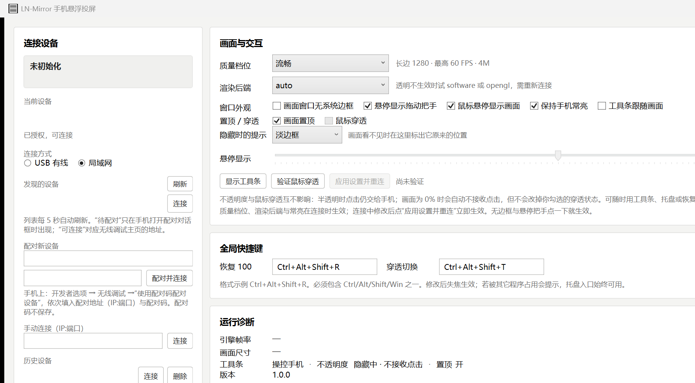

<div align="center">

<h1>LN-Mirror</h1>

<p><b>把安卓手机挂到 Windows 桌面上：</b><br/>
半透明放着不打扰工作，鼠标挪过去就能直接点，不用的时候就让它几乎看不见。</p>

<p>
<a href="https://github.com/LinLey-Nancy/LN-Mirror/releases/latest"></a>


</p>

<p>
<b><a href="https://github.com/LinLey-Nancy/LN-Mirror/releases/latest">下载便携包</a></b> ·
<a href="docs/使用说明.md">使用说明</a> ·
<a href="docs/Android-Windows投屏方案.md">设计文档</a> ·
<a href="CHANGELOG.md">更新日志</a>
</p>

</div>

## 30 秒上手

1. 从 [Release](https://github.com/LinLey-Nancy/LN-Mirror/releases/latest) 下载 zip，解压到任意文件夹（免安装）
2. 手机打开「开发者选项 → 无线调试」，或者插 USB 线
3. 启动 LN-Mirror，按主界面的提示配对一次（Wi-Fi 首次连接要用配对码），画面就出现在桌面上了

## 它解决什么

回条消息、看一眼验证码、扫个码，都得把手机解锁——切出去，用完再切回来，来回几次手上正事就停了。

LN-Mirror 的做法是让手机画面**一直待在桌面上**：半透明摆在角落，不影响手上的活儿；要用的时候鼠标挪过去直接点；用完让它透明待着就好。



*主界面：左边完成配对和连接，右边把外观、透明度、穿透、悬停和快捷键一次配齐。*

## 好在哪里

- **悬停才出现**：画面平时透明得几乎看不到；鼠标停到它的位置上，它才浮现出来。完全透明时连点击都不收，不会误碰电脑。
- **半透明照样能点**：不透明度从全透明到全不透明随便调，调到一半也不影响操作手机。
- **置顶，边框说没就没**：画面可以一直浮在所有窗口前面；「无边框」一勾马上生效，不用重新连接。
- **丢了不怕**：画面完全看不见之后，可以在原地画一条淡边框或者一个角标提醒你它在哪；也可以按 `Ctrl+Alt+Shift+R` 直接恢复。
- **工具条就在旁边**：不透明度、操控手机、置顶、找回画面，都放在画面旁边的工具条上，点一下就完事。
- **无线也稳**：配对一次之后，Wi-Fi 断线自动重连，手机换了 IP 也认得；不方便无线时插上 USB 一样能连。

## 它是怎么工作的

- 画面从头到尾都是官方 scrcpy 在显示。LN-Mirror 只做三件事：**管连接**、**管窗口外观**（让它透明、可穿透、去边框）、**管工具条和托盘**。没有第二套绘制和坐标换算，也就没有第二套可能出问题的地方。
- 引擎固定用包里自带的 scrcpy 5.0.1，电脑端和手机端永远是一对，不会混用。
- 更完整的设计（怎么可靠找到画面窗口、退出的顺序、悬停判定），见 [docs/Android-Windows投屏方案.md](docs/Android-Windows投屏方案.md)。

## 从源码构建

前置：本机装有 .NET SDK 10（`dotnet --version`）。scrcpy 引擎由仓库 `tools/` 提供，不用单独安装。

```powershell
# 拉取官方 scrcpy 并按 SHA256 校验（升级引擎版本时用）
powershell -NoProfile -ExecutionPolicy Bypass -File scripts\fetch-scrcpy.ps1 -Version v5.0.1

# 构建便携包：发布 + 包内自检 + 打 ZIP + 输出 SHA256
powershell -NoProfile -ExecutionPolicy Bypass -File scripts\build.ps1

# 或者日常开发直接跑
dotnet build src\LN-Mirror\LN-Mirror.csproj
dotnet run --project src\LN-Mirror -- --smoke-ui
```

生成应用图标（改了图标绘制逻辑时才需要）：

```powershell
powershell -NoProfile -ExecutionPolicy Bypass -File scripts\make-icon.ps1
```

## 命令行开关

| 开关 | 作用 |
|---|---|
| `--smoke-ui` | 界面冒烟检查：显示主窗口与工具条 3 秒后自动退出，退出码 0 表示启动无异常。**不连手机、不写配置** |
| `--exit-after <秒>` | 跑 N 秒后自动退出，退出路径和托盘「退出」完全一样，用来验证退出流程（会按设置连接手机） |
| `--self-test` | 弹窗形式的环境自检（引擎、adb、配置目录、整窗 alpha 读写） |
| `--self-test --report <路径>` | 同上，但把报告写到文件，方便自动化核对 |
| `--version` | 显示版本号 |

## 哪些测过、哪些没测

如实列出，方便你判断这版在自己的机器上靠不靠谱。没写「跑过」的不代表有问题，只是还没逐条确认。

| 功能 | 状态 |
|---|---|
| 无线连接：配对、自动发现、断线重连、连着手机退出 | 真机跑过（2026-10-23） |
| 退出后进程正常结束 | 真机跑过 |
| 悬停显示、位置提示、无边框切换 | 写好了，还没长时间使用过 |
| 音频转发 | 还没做 |
| 显卡驱动下透明、穿透的表现 | 没验证，要按 [docs/M0验证清单.md](docs/M0验证清单.md) 一条条测 |
| 无线网络下的配对和流畅度 | 没验证，同上 |

## 文档

| 文档 | 用途 |
|---|---|
| [docs/使用说明.md](docs/使用说明.md) | 日常工作用：安装、配对、操作、排障 |
| [docs/Android-Windows投屏方案.md](docs/Android-Windows投屏方案.md) | 详细设计 |
| [docs/M0验证清单.md](docs/M0验证清单.md) | 透明、穿透、快捷键的实机验证清单 |
| [docs/投屏界面草图.html](docs/投屏界面草图.html) | 交互概念草图（浏览器打开） |
| [CHANGELOG.md](CHANGELOG.md) | 每个版本改了什么 |

## 隐私

- 程序不收集、不上报任何数据。唯一的网络活动，是和你**自己的手机**建立投屏连接。
- 日志只记连接状态、版本、错误和性能诊断；不记画面、输入内容、剪贴板、配对码和 ADB 私钥。
- 日志位置：`%APPDATA%\LN-Mirror\logs`

## 许可

包里的 scrcpy 是官方原版、未做修改；版本、来源与 SHA256 记录在 [`tools/SCRCPY-VERSION.txt`](tools/SCRCPY-VERSION.txt)，Apache-2.0 许可文件跟引擎放在一起。
