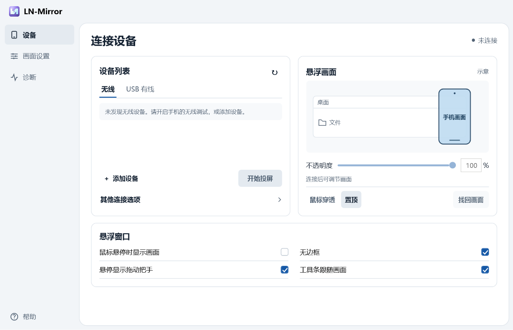

<div align="center">

<p>

</p>

<h1>LN-Mirror</h1>

<p>在 Windows 桌面上显示一个半透明的安卓手机画面，也可以管理普通应用窗口的透明度、图片覆盖和悬停显示。</p>

<p>
<a href="https://github.com/LinLey-Nancy/LN-Mirror/releases/latest"></a>


</p>

<p>
<b><a href="https://github.com/LinLey-Nancy/LN-Mirror/releases/latest">下载便携包</a></b> ·
<a href="docs/使用说明.md">使用说明</a> ·
<a href="docs/Android-Windows投屏方案.md">设计文档</a> ·
<a href="CHANGELOG.md">更新日志</a>
</p>

</div>

## 快速开始

1. 从 [Release](https://github.com/LinLey-Nancy/LN-Mirror/releases/latest) 下载 zip，解压到任意文件夹，不需要安装
2. 在手机上打开「开发者选项 → 无线调试」，或者直接插 USB 线
3. 启动 LN-Mirror，按主界面的提示完成一次配对（无线连接首次使用需要配对码），手机画面就会出现在桌面上

## 解决什么问题

想回一条消息、看一眼验证码、扫一个二维码，都要先解锁手机，切出去再用回来，来回几次就会打断手上的工作。

LN-Mirror 让手机画面常驻桌面：半透明放在角落，不遮挡正在进行的工作；需要时用鼠标直接操作手机，操作完继续做事。



*设备页把「无线」和「USB 有线」设备分开显示，右侧是悬浮画面预览，下方可以调整悬浮窗口。功能旁的圆形问号可查看说明；首次使用可在左下角打开「帮助」查看连接教程。*

## 主要功能

- **悬停显示**：画面平时几乎完全透明，鼠标停到它的位置上时才显示出来。完全透明时它不接受鼠标点击，不会挡住下面的窗口。勾选「移开仍显示」后，鼠标移开仍保持显示，直到下一次鼠标点击才关闭。
- **半透明也能操作**：不透明度可以在 0 到 100 之间连续调整；半透明状态下依然可以直接点击、输入和滚动。
- **置顶与边框**：画面可以置顶显示在所有窗口之上；勾选「无边框」立即生效，不需要重新连接。无边框画面四条边只有中间一段用于移动窗口，四个角用于按比例缩放，减少误触。
- **位置提示**：画面完全不可见时，可以在原地显示一条淡边框或一个角标，提醒它在这里；也可以按 Ctrl+Alt+Shift+R 恢复不透明。
- **工具条**：画面旁边附一条工具条，集中了不透明度、鼠标穿透、置顶、找回画面等常用操作，按住工具条的空白处可以拖动它。
- **无线优先**：配对一次后，Wi-Fi 断线自动重连，手机地址变了也能自动找到；需要时也可以插 USB 线连接。设备页按「无线」和「USB 有线」分类显示，同一部手机同时使用两种连接时，两个页签各显示一个对应条目，不会重复成两台同名设备。
- **应用窗口管理**：顶部「应用」页列出一个可选择的普通 Windows 主窗口，支持透明度、置顶、悬停显示，以及始终图片或平时图片、悬停显示原窗口两种覆盖模式；两种悬停模式也支持「移开仍显示」。
- **问号说明**：需要解释功能、使用后果、模式区别或参数含义的选项旁有一个圆形问号。鼠标悬停或用键盘聚焦即可查看说明，按钮和复选框本身只显示名称。
- **切换器隐藏**：可将目标窗口从 Alt+Tab 中移除，并尝试从 Win+Tab 中移除；通常也会隐藏任务栏按钮，具体表现按应用验证。
- **按需提权**：高权限窗口由用户确认 UAC 后，通过独立辅助进程重试。不注入目标进程，不读写目标内存，不转发模拟输入。
- **异常恢复**：切换目标、结束管理和退出时恢复原样式；异常退出后，下次启动按窗口与进程身份核对并尝试恢复。

## 工作方式

手机画面始终由官方 scrcpy 显示，LN-Mirror 负责连接管理、窗口外观（透明、穿透、边框），以及工具条和托盘。它不重新绘制手机画面，也不做输入坐标的二次换算。

普通应用窗口通过 Windows 公开接口管理。图片模式使用跟随目标窗口的鼠标穿透覆盖层，原应用继续处理实际输入；不会向目标进程注入代码。独立弹窗和菜单不在首版管理范围内。带反作弊的游戏不在兼容承诺内。

程序只使用包内自带的 scrcpy 5.0.1，电脑端与手机端的版本组合是固定的，不会混用。

完整的设计说明（窗口识别、退出流程、悬停判定等）见 [docs/Android-Windows投屏方案.md](docs/Android-Windows投屏方案.md)。

## 从源码构建

前置：本机装有 .NET SDK 10（用 `dotnet --version` 确认）。scrcpy 引擎由仓库 `tools/` 目录提供，不需要单独下载。

```powershell
# 下载官方 scrcpy 并按 SHA256 校验（升级引擎版本时使用）
powershell -NoProfile -ExecutionPolicy Bypass -File scripts\fetch-scrcpy.ps1 -Version v5.0.1

# 构建便携包：发布、包内自检、打 ZIP、输出 SHA256
powershell -NoProfile -ExecutionPolicy Bypass -File scripts\build.ps1

# 日常开发可以直接编译运行
dotnet build src\LN-Mirror\LN-Mirror.csproj
dotnet run --project src\LN-Mirror -- --smoke-ui
```

生成应用图标（仅在修改了图标绘制代码时需要）：

```powershell
powershell -NoProfile -ExecutionPolicy Bypass -File scripts\make-icon.ps1
```

## 命令行开关

| 开关 | 作用 |
|---|---|
| `--smoke-ui` | 界面检查：显示主窗口和工具条 3 秒后自动退出，退出码 0 表示启动无异常。不连接手机，不写配置 |
| `--exit-after <秒>` | 运行 N 秒后自动退出，退出路径与托盘「退出」完全相同，用于验证退出流程（会按设置连接手机） |
| `--self-test` | 弹窗形式的环境自检：引擎、adb、配置目录、窗口透明设置的读取与写入 |
| `--self-test --report <路径>` | 同上，但把检查结果写到文件，便于自动化核对 |
| `--version` | 显示版本号 |

## 验证情况

以下内容如实记录，方便判断这版程序是否适合你的机器。没有标注「已验证」的功能不代表有问题，只是还没有逐条确认。

| 功能 | 状态 |
|---|---|
| 无线连接：配对、自动发现、断线重连、连接手机时退出 | 已在真机验证（2026-10-23） |
| 退出后进程正常结束 | 已在真机验证 |
| 悬停显示、位置提示、无边框切换 | 已实现，尚未经过长时间实际使用 |
| 设备按连接方式分类、移开仍显示、圆形问号说明 | 已实现并通过自动回归；真实鼠标与真机验收待完成 |
| 音频转发 | 未实现 |
| 显卡驱动下透明、穿透的表现 | 未验证，需按 [docs/M0验证清单.md](docs/M0验证清单.md) 逐项确认 |
| 无线网络下的配对与流畅度 | 未验证，同上 |

## 文档

| 文档 | 用途 |
|---|---|
| [docs/使用说明.md](docs/使用说明.md) | 日常使用：安装、配对、操作、故障处理 |
| [docs/Android-Windows投屏方案.md](docs/Android-Windows投屏方案.md) | 详细设计 |
| [docs/M0验证清单.md](docs/M0验证清单.md) | 透明、穿透、快捷键的实机验证清单 |
| [docs/投屏界面草图.html](docs/投屏界面草图.html) | 交互概念草图，用浏览器打开 |
| [CHANGELOG.md](CHANGELOG.md) | 每个版本的变更内容 |

## 隐私

程序不收集、不上报任何数据。唯一的网络活动，是与自己的手机建立投屏连接。

日志只记录连接状态、版本、错误和性能诊断，不记录画面内容、输入内容、剪贴板、配对码和 ADB 私钥。日志位于 `%APPDATA%\LN-Mirror\logs`。

## 许可

包内的 scrcpy 是官方原版，未做修改。版本、来源与 SHA256 记录在 [`tools/SCRCPY-VERSION.txt`](tools/SCRCPY-VERSION.txt)，Apache-2.0 许可文件随引擎目录一起分发。
